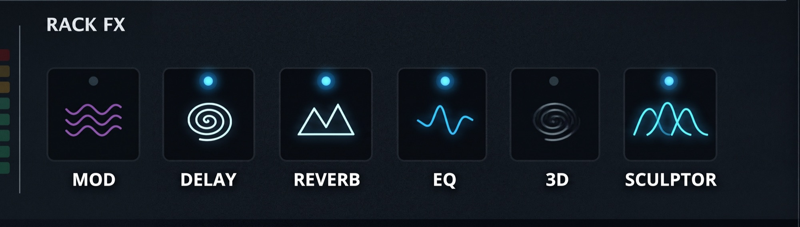
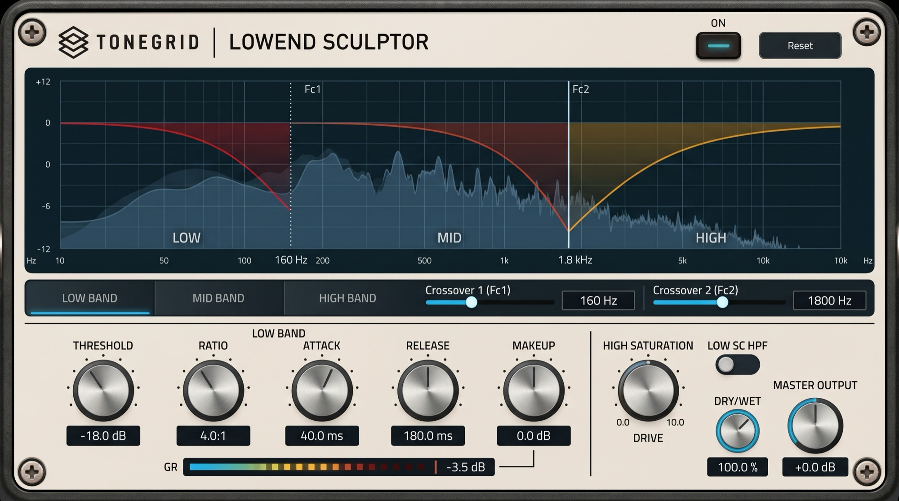

# Feature request: LowEnd Sculptor — 3-band multiband compressor for bass and guitar

| Field | Value |
| :--- | :--- |
| Status | Proposal, ready for review |
| Type | New audio effect, new Rack FX item, new editor page |
| Target branch | `feature/multiband_compressor` |
| Engineering spec | [`multiband-compressor-spec.md`](multiband-compressor-spec.md) |
| Mockups | [`rackfx.jpeg`](rackfx.jpeg), [`tonegrid-multiband-compressor.jpeg`](tonegrid-multiband-compressor.jpeg) |

---

## 1. Summary

Add a three-band compressor to the Rack FX section. It splits the signal at two user
crossovers, compresses each band with its own threshold, ratio, attack, release and makeup,
optionally saturates the high band, and sums the bands back with an exactly flat response.

Today ToneGrid has one compressor: the single-band Studio Comp pedal. It works well on the
whole signal, but it cannot treat the low end and the top end differently. That is the gap this
feature fills. It matters for bass players first, and it matters for guitar players more than
most people expect.

---

## 2. Why this is worth building

### 2.1 The problem with one-band compression

A guitar or bass note is not one frequency. A 5-string bass covers 31 Hz to about 4 kHz. A
7-string guitar in drop tuning covers 62 Hz to well above 6 kHz. A compressor with a single
detector sees one number: the total energy of everything at that moment.

The loudest part of a bass note is almost always the fundamental, at 40 to 100 Hz. So a
single-band compressor makes its decision on the low end and then applies that decision to the
whole signal. The result is familiar to every bassist who has tried it:

- The high notes duck when a low note lands.
- The attack of a slap disappears, because the pop at 2 to 4 kHz gets reduced by a gain change
  that the low string caused.
- The part pumps, because a sustained low note holds the detector down for a long time.
- With a fast release, the low end distorts the envelope of the mids.

The same thing happens to a guitarist, just at different frequencies. This is why multiband
compression exists in mixing, and why bassists have asked for it in pedals for years.

### 2.2 What three bands change

Each band makes its own decision, at its own speed, with its own amount. The low band can be
firm and slow, the high band light and fast. That is the whole idea, and it produces results a
single-band compressor cannot:

- **Control without dulling.** Compress 40 to 160 Hz to tighten the low end, leave 1 kHz and up
  alone, and the attack stays.
- **Stable level across the neck.** A low E and a high G come out at a similar level, so the
  part sounds even.
- **One band can sustain while another snaps.** A slow low band adds body; a fast high band
  keeps the pick or finger noise.

### 2.3 Why a guitarist wants it too

Most guitarists think of multiband compression as a bass tool. In practice it solves problems
that guitar players hit every day:

| Guitar situation | What goes wrong with one band | What three bands fix |
| :--- | :--- | :--- |
| Palm mutes against open chords | The low chug spikes 10 dB and ducks the whole signal; the part breathes with every mute | LOW band takes the spike; MID and HIGH stay steady |
| Drop and low tunings | The lowest string dominates the detector, so the rest of the chord disappears | The detector for each band sees only its own range |
| High-gain rhythm | A single-band comp smears the attack or adds pumping; a boost pedal fixes the tightness but changes the tone | LOW compression tightens the chug without touching the mid character |
| Clean funk and neo-soul | Chords and single notes sit at different levels, and the snap gets compressed away | MID and HIGH stay dynamic; LOW stays controlled |
| Amp and cab boom around 100 to 250 Hz | A broadband comp reduces the boom, but also reduces the pick attack | LOW band only, with the attack band untouched |
| Leads over a rhythm loop | The loop is compressed for consistency, and the lead loses its dynamics with it | Different ratio and attack per band |

The high-band saturation stage is a guitar feature as much as a bass one. It adds density and
harmonic movement to the top end, without adding fuzz to the low end, which is where guitar
distortion usually turns to mush.

### 2.4 Why three bands and not two, or five

Two bands cannot separate "boom" from "body" from "attack", which is the range that matters
most here. Five bands turns the page into a mixing console and makes every preset depend on
five crossovers. Three bands with two crossovers, defaulted at 160 Hz and 1.8 kHz, covers the
low end, the body and the attack, and the player can move both crossovers to match the
instrument.

### 2.5 Why the crossover has to be phase-correct

The three bands add back to the input signal, exactly, when every ratio is at 1:1. The
magnitude response is flat at every crossover setting, and the dry path is phase-aligned with
the wet path, so the dry/wet knob never combs.

This is not a detail for engineers only. It is the reason the effect can sit at 30 percent mix
and still sound like the amp. A simple filter split leaves a dip at each crossover, and that
dip is audible as a hollow spot in the low mids.

### 2.6 Why it belongs in Rack FX

- It works on the sound the player actually hears, so it goes after the amp and cabinet and
  after Amp EQ.
- It goes before 3D Sound, so the low band stays centered and the widener never has to deal
  with a mono signal.
- It must not take one of the thirteen pedal slots. Those belong to drives, fuzz and wah.
- A pedal card has three knobs. This effect needs five per band, two crossovers and a display.

---

## 3. Proposed design

### 3.1 Where it sits

```
guitar -> 13 pedals -> amp -> cabinet -> Normalization -> Amp EQ
       -> LOWEND SCULPTOR -> 3D Sound -> Mod -> Delay -> Reverb -> output
```

Zero added latency. No limiter. The module is off in every existing rig and preset, so nothing
changes until the player turns it on.

### 3.2 The Rack FX panel



*The Rack FX panel. Six items in one row. Sculptor is the last tile, with the three-band curve
icon.*

Each tile has a status LED, a line icon and a caption. A click switches the effect on or off. A
gear appears on hover and opens the editor page.

### 3.3 The editor page



*The editor page: spectrum with band curves on top, band tabs, crossovers, five knobs per band,
high-band saturation, low sidechain filter, dry/wet, master output and gain-reduction meter.*

What each part does:

- **Spectrum and band curves.** The filled shape is the incoming signal. The three curves show
  what each band is doing to it right now: crossover shape plus current makeup minus current
  gain reduction. The player sees where the low end is and how much it is being held down.
- **Band tabs.** One set of five knobs, three bands. The tab switches which band the knobs
  edit, so the page stays readable and no knob is duplicated.
- **Crossovers.** `Fc1` and `Fc2`, with the exact frequency in a field next to each slider.
- **Low band.** Threshold, ratio, attack, release, makeup. Default 4:1, 40 ms attack, 180 ms
  release. Slow and firm, the way a bass low end wants to be.
- **High band.** Same five controls, default 2.5:1 with a fast 10 ms attack, so it catches
  pick noise without killing it.
- **High Saturation.** Drive from 0 to 10 on the high band only. Off means off, not "almost
  off".
- **Low SC HPF.** High-passes the low band's detector, not the audio, so sub rumble and stage
  noise do not trigger gain reduction. The bass still passes.
- **Dry/wet.** Phase-aligned, so 50 percent is a usable setting and not a comb filter.
- **Gain-reduction meter.** One bar with a peak hold. It shows the largest reduction in any
  band, which is the number that matters when setting a threshold.

### 3.4 Parameters

| Group | Controls | Range | Default |
| :--- | :--- | :--- | :--- |
| LOW / MID / HIGH, each | Threshold | -48 to 0 dB | -18 / -14 / -12 dB |
| | Ratio | 1:1 to 20:1 | 4 / 3 / 2.5 |
| | Attack | 0.5 to 200 ms | 40 / 20 / 10 ms |
| | Release | 10 to 2000 ms | 180 / 100 / 80 ms |
| | Makeup | -12 to +24 dB | 0 dB |
| Crossover | Fc1 | 40 to 400 Hz | 160 Hz |
| | Fc2 | 500 to 8000 Hz | 1800 Hz |
| Global | High saturation drive | 0 to 10 | 0 |
| | Low sidechain HPF | off / on | off |
| | Dry / wet | 0 to 100 % | 100 % |
| | Master output | -24 to +24 dB | 0 dB |

Twenty continuous values and two switches. Everything is saved in the rig.

---

## 4. What success looks like

1. **Transparent when unused.** All ratios at 1:1, drive at 0, mix at 100 percent: the output is
   flat within 0.1 dB from 20 Hz to 20 kHz at every legal crossover pair. Verified by an
   offline test, not by ear.
2. **No click.** Bypass, crossover moves and reset all fade over 8 ms.
3. **No comb.** At 50 percent mix there is no notch at either crossover.
4. **Cheap.** Under 1 percent of one core for a stereo instance at 48 kHz.
5. **Off by default.** A fresh rig and every shipped preset sound exactly as they do today.

Listening checks before release:

- Bass into a clean amp: 4:1 on the LOW band at 160 Hz tightens the low end and the attack
  survives.
- High-gain guitar: palm mutes stay even, chords do not duck.
- Move both crossovers on a sustained note: no click, no level jump.
- Drive from 0 to 10 on a chord: grit arrives, level stays put.

---

## 5. Scope

In scope:

- One DSP engine, one graph node, one Rack FX tile, one editor page.
- Persistence in the output settings block, fully backward compatible.
- Offline tests for the crossover, dynamics, saturation, dry/wet, persistence and CPU.

Out of scope, for now:

- Lookahead, oversampling, external sidechain.
- Per-band solo, mute or bypass.
- A limiter or output ceiling.
- Per-preset values for the module. It loads off.
- Any change to the thirteen pedals, the pedal order, or the preset bank.

---

## 6. Open questions

1. **Panel scope.** The mockup shows a new Rack FX panel with six tiles. The build today has
   four items inside the amp chassis. Do we build the panel in this branch, or in a separate UI
   branch? Recommendation: same branch, because the tile is the entry point in the design.
2. **EQ and PITCH.** EQ becomes a tile that opens the existing Amp EQ page. PITCH stays where it
   is. Confirm both.
3. **Presets.** Should a preset be able to switch this module on with stored values?
   Recommendation: no for v1, since it needs a preset schema bump for a module most presets
   would leave off.

---

## 7. Implementation phases

- [ ] **P1, DSP and tests.** Engine, crossover, three compressors, saturation, dry/wet. Passes
      the flat-sum test at 44.1, 48 and 96 kHz.
- [ ] **P2, node and persistence.** Graph insertion after Amp EQ, output settings version 8,
      round-trip and compatibility tests.
- [ ] **P3, panel and page.** Tile, editor page, analyzer, meter, screenshots at both window
      sizes.
- [ ] **P4, polish.** Help text, tooltips, release note, downgrade warning.

The full engineering details, parameter IDs, codec rules and test matrix are in
[`multiband-compressor-spec.md`](multiband-compressor-spec.md).
